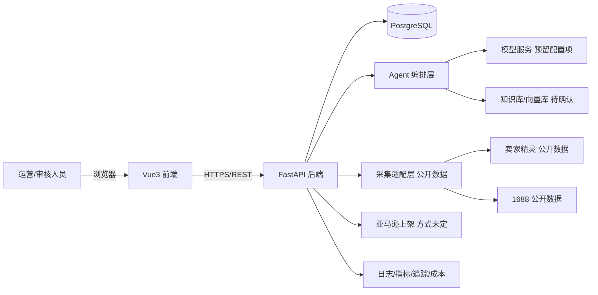
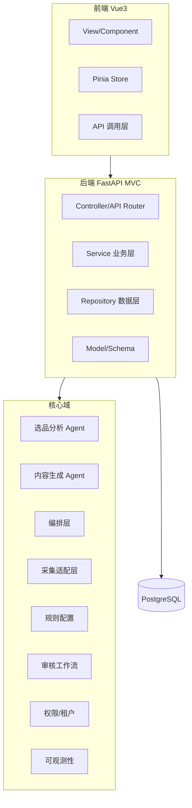
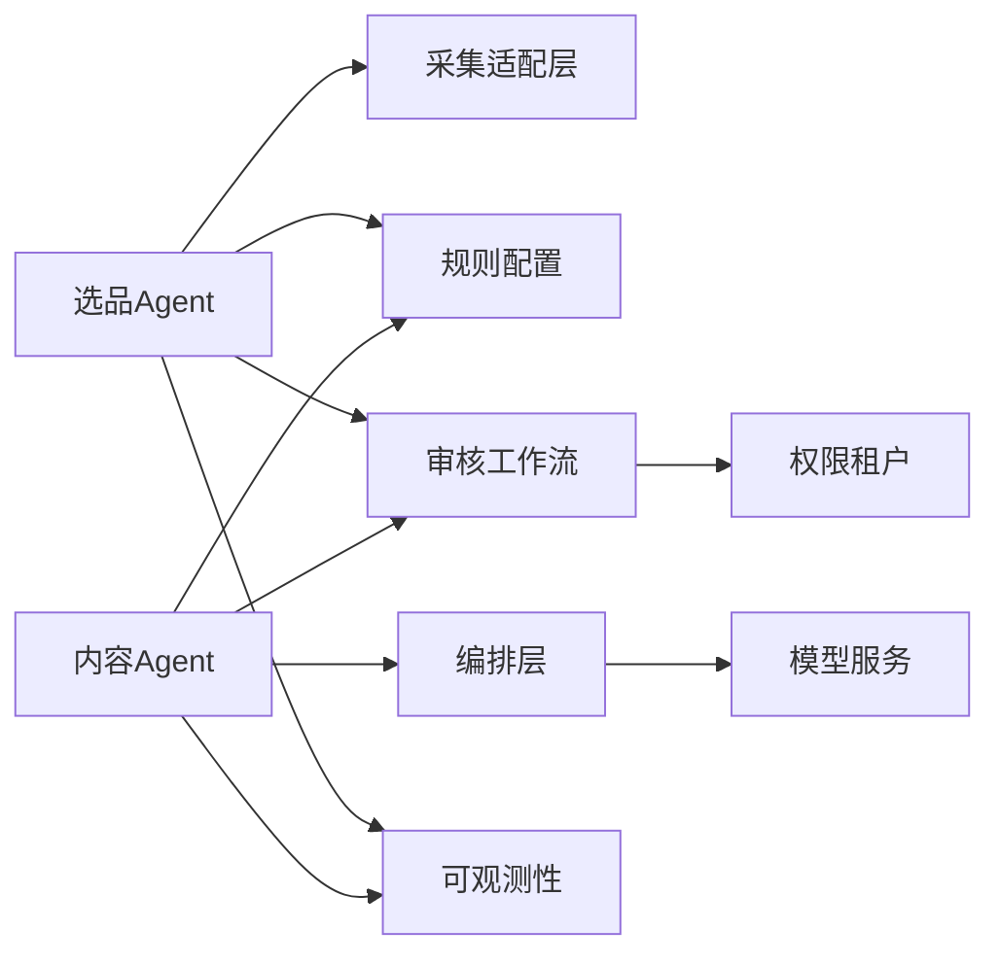

# 概要设计说明书

> 项目：AI 跨境电商（选品分析 Agent + 商品内容生成 Agent）
> 版本：v1.2（2026-11-24 门禁修订，未通过）
> 前置输入：`docs/requirements-analysis.md`（BR-001~BR-028、A-01~A-14）
> 更新说明：爬取公开数据；利润公式/汇率前端可配置；侵权查专利+商标；亚马逊上架未定；模型服务预留配置项。
> 定位：只做概要设计，不展开详细设计，不写具体代码、不写 SQL DDL。

---

## 1. 文档信息与修订记录

| 项目 | 内容 |
|---|---|
| 文档名称 | 概要设计说明书 |
| 适用范围 | 系统总体架构、模块划分、技术选型、数据/接口/部署概要、风险与演进 |
| 读者 | 架构师、技术负责人、前端/后端/测试负责人、运营代表 |
| 前置文档 | 需求分析与假设/待确认清单（BR/A 编号来源） |
| 后续文档 | 详细设计说明书（展开模块/表/接口/伪代码）、测试用例 |

| 版本 | 日期 | 作者 | 变更说明 |
|---|---|---|---|
| v0.1 | 待填写 | 待填写 | 初稿 |
| v1.0 | 待填写 | 待填写 | 评审稿 |
| v1.2 | 2026-11-24 | AI | 门禁修订：补全异常、工具契约、待确认计划；尚未通过门禁 |

---

## 2. 背景与目标

### 2.1 背景

项目为 AI 跨境电商实训项目，包含选品分析 Agent 与商品内容生成 Agent 两条流水线。当前无目标平台账号与 API，暂定使用爬虫技术在线采集**公开数据**；爬虫涉及平台条款、robots、反爬、账号风控与数据合规风险，须作为风险管理（A-01、A-02），不得默认合法可用。利润公式/汇率、侵权（专利+商标）、模型服务已按 2026-11-24 用户确认更新。

### 2.2 目标

1. 构建可配置、可审计、可降级的选品与内容生成流水线，支撑“抓取→匹配→测算→拦截→两阶段核验→生成→审核→上架（暂定）”端到端业务。
2. 将利润/销售额筛选规则与审核逻辑抽离为可配置、可版本化资产，满足 BR-004、BR-005、BR-011、BR-012。
3. 以 MVC 分层 + Agent 编排 + 人工兜底保证业务可控与 AI 风险可控（幻觉、注入、成本）。

### 2.3 本期范围 / 不包含范围

见需求分析第 2 章（S-01~S-10 / O-01~O-07）。概要设计仅覆盖本期范围；O 项作为预留扩展点（第 12 章）。

---

## 3. 需求概述与约束

### 3.1 角色（摘要）

系统管理员、运营人员、选品审核员、内容审核员、上架操作员、只读审计员、Agent 系统账号。权限模型假设 RBAC + 租户隔离（A-10）。

### 3.2 核心业务规则（摘要）

BR-001~BR-028 全量见需求分析第 4 章。概要设计重点保障：

- BR-004 OR 逻辑与 BR-005 可配置、BR-006 版本冻结；BR-028 利润公式/汇率前端可配置；
- BR-007 侵权拦截（专利+商标双维度）、BR-009 两阶段核验、BR-013 内容人工审核；
- BR-016 合规开关、BR-019 幂等、BR-022 低置信转人工、BR-026 注入防护、BR-027 幻觉兜底。

### 3.3 技术约束

- 前端 Vue3（Composition API、Vue Router、Pinia、Axios）；后端 Python 3.11+、FastAPI、Pydantic、SQLAlchemy/SQLModel、Alembic、Uvicorn、Pytest；数据库 PostgreSQL；RESTful + OpenAPI 契约。
- 后端 MVC 分层：Controller/API Router → Service → Repository → Model/Schema；禁止业务逻辑写在 Controller。
- 爬虫框架、Agent 编排框架、向量库、对象存储未明确，按 A-11 待确认；模型服务先预留配置项（A-09）；概要设计仅定义适配层接口，不锁定具体框架。
- 部署 Docker、Nginx、Jenkins、Harbor、GitLab CI/CD；环境 DEV/SIT/UAT/PROD。

### 3.4 跨组依赖（摘要）

见需求分析第 7 章；接口契约清单与冻结点见第 8.5 节。

---

## 4. 总体架构

### 4.1 系统上下文图

### 4.2 总体架构图

### 4.3 MVC 分层架构

| 层 | 职责 | 禁止事项 |
|---|---|---|
| Controller/API Router | 参数校验、鉴权、响应封装、HTTP 状态码 | 禁止业务逻辑、禁止直连 DB |
| Service | 业务规则、状态流转、事务、编排调用 | 禁止 HTTP 细节 |
| Repository | 数据访问、查询、持久化 | 禁止业务规则 |
| Model/Schema | ORM 模型、Pydantic 契约 | 禁止业务逻辑 |

前端分层：View/Component → Store（Pinia）→ API 调用层（Axios）→ Router（路由守卫）。

### 4.4 架构风格与 ADR

- 风格：分层单体 + 适配器（采集/模型/上架）+ Agent 编排；本期不拆微服务，预留服务拆分点。
- ADR-01：采用单体分层而非微服务，降低实训项目复杂度；采集与 Agent 以模块 + 队列隔离。
- ADR-02：爬虫与模型均经适配层接入，外部依赖可替换、可开关（A-01、A-11）。
- ADR-03：规则与审核逻辑数据化、版本化，不硬编码（BR-005、BR-011）。

---

## 5. 模块划分与职责

### 5.1 模块清单

| 模块 | 职责 | 依赖 |
|---|---|---|
| 选品分析 Agent | 抓取公开数据→匹配→测算（可配置公式/汇率）→筛选→商品池 | 采集适配层、规则配置、侵权校验 |
| 商品内容生成 Agent | 生成内容→审核逻辑→人工审核→上架任务 | 编排层、模型服务（预留配置）、审核工作流 |
| 编排层 | Agent 步骤编排、工具调用、重试、降级、成本记录 | 模型服务（预留配置）、知识库 |
| 采集适配层 | 卖家精灵/1688 公开数据适配器、限流、重试、失败队列、质量校验、合规开关 | 外部公开页面 |
| 侵权校验 | 专利+商标双维度校验、综合结论、证据留存 | 专利库/商标库（覆盖待确认 A-05） |
| 规则配置 | 利润公式/汇率/筛选规则/审核逻辑的编辑、版本、回滚、发布 | 权限、审计 |
| 审核工作流 | 两阶段核验、内容审核、上架确认、SLA | 任务分发、通知（待确认） |
| 权限租户 | RBAC、租户隔离、审计 | 用户/角色 |
| 可观测性 | 日志、指标、追踪、Token 成本、告警 | 全模块 |

### 5.2 依赖关系图

---

## 6. 技术选型

| 领域 | 选型 | 理由 | 替代方案 | 风险 |
|---|---|---|---|---|
| 前端 | Vue3 + Router + Pinia + Axios | 满足基线，生态成熟 | React（不采用） | 低 |
| 后端 | FastAPI + Pydantic + SQLAlchemy + Alembic | 满足基线，OpenAPI 原生 | Django（不采用） | 低 |
| 数据库 | PostgreSQL | 满足基线，事务与 JSON 能力 | MySQL（不采用） | 低 |
| 爬虫 | Playwright 或 Scrapy（待确认 A-11） | 需兼顾渲染与规模 | Selenium（备选） | 页面结构变化、反爬（A-02） |
| Agent 编排 | 待确认（A-11） | 仅定义编排接口 | LangGraph 等（待评估） | 框架锁定风险 |
| 模型服务 | 预留配置项（A-09） | 供应商/模型/密钥/配额/超时可配置，仅定义接入契约 | 多供应商适配 | 成本/配额未定 |
| 向量库/对象存储 | 待确认（A-11） | 仅预留接口 | pgvector/MinIO 等（待评估） | 选型未定 |
| 部署 | Docker + Nginx + Jenkins + Harbor + GitLab CI | 满足基线 | K8s（L3 演进） | 环境资源未定（A-12） |

> 未确认选型不得在详细设计中锁定具体产品；仅定义接口与替换点。

---

## 7. 数据架构概要

### 7.1 核心实体（概要）

商品、货源、利润测算（含公式版本+汇率快照）、侵权校验（专利/商标双维度）、筛选规则（含公式/汇率配置+版本）、核验任务、内容任务、生成内容、审核逻辑（含版本）、审核记录、上架任务、采集任务、Agent 运行、Prompt 版本、知识库文档、模型调用日志。字段与约束见详细设计第 6 章。

### 7.2 数据流与来源

- 来源：卖家精灵（商品）、1688（货源）、模型生成（内容）、人工输入（规则/审核）。
- 流向：原始区 → 质量校验 → 主表 → 测算/校验 → 池流转 → 生成/审核 → 上架。
- 租户隔离：所有业务表预留 `tenant_id`（A-10 待确认）；查询强制带租户条件。
- 备份：PostgreSQL 定时备份 + 恢复演练（策略待确认）。

---

## 8. 接口概要

### 8.1 接口清单（概要）

| 分组 | 接口（方法 + 路径概要） | 鉴权 | 同步/异步 | 版本 | 说明 |
|---|---|---|---|---|---|
| 商品池 | `GET /api/v1/products/pool`、`GET /api/v1/products/{id}` | 登录 | 同步 | v1 | 池列表/详情 |
| 候选池 | `GET /api/v1/products/candidates` | 登录 | 同步 | v1 | 候选列表 |
| 核验 | `POST /api/v1/reviews/{taskId}/approve`、`POST /api/v1/reviews/{taskId}/reject` | 审核员 | 同步 | v1 | 初核/复核 |
| 筛选规则 | `GET/POST /api/v1/selection-rules`、`POST /api/v1/selection-rules/{id}/publish`、`POST /api/v1/selection-rules/{id}/rollback` | 运营 | 同步 | v1 | 配置与版本 |
| 采集 | `POST /api/v1/crawl-tasks`、`GET /api/v1/crawl-tasks/{id}` | 运营/系统；查询需登录 | 创建异步、查询同步 | v1 | 任务创建/查询 |
| 内容生成 | `POST /api/v1/content-jobs`、`GET /api/v1/content-jobs/{id}` | 系统/运营；查询需登录 | 创建异步、查询同步 | v1 | 生成任务 |
| 审核逻辑 | `GET/POST /api/v1/audit-rules`、`POST /api/v1/audit-rules/{id}/publish`、`POST /api/v1/audit-rules/{id}/rollback` | 运营 | 同步 | v1 | 运营可编辑 |
| 内容审核 | `POST /api/v1/content-reviews/{id}/approve`、`POST /api/v1/content-reviews/{id}/reject` | 内容审核员 | 同步 | v1 | 人工终审 |
| 上架 | `POST /api/v1/listing-jobs`、`GET /api/v1/listing-jobs/{id}` | 上架操作员；查询需登录 | 创建同步登记、查询同步 | v1 | 仅任务登记，处理方式未定 |
| 审计/成本 | `GET /api/v1/audit-logs`、`GET /api/v1/agent-costs` | 审计员/运营 | 同步 | v1 | 审计与成本 |

> 契约草案见详细设计第 7 章；逐接口 Schema 及 OpenAPI 尚未冻结；本章仅列清单。

### 8.2 关键契约

- 统一响应结构、统一错误码、分页/排序/过滤规范（详细设计第 7、10 章）。
- 所有写操作支持幂等键（`Idempotency-Key`）；关键状态流转需版本/乐观锁（BR-019、BR-020）。

### 8.3 同步/异步

- 同步：池查询、核验、规则编辑、审核。
- 异步：采集、货源匹配、利润测算（批量）、内容生成、上架；以任务 ID 轮询/回调（待确认）。

### 8.4 幂等/重试/限流

- 幂等：采集、测算、生成、上架均幂等；重复提交返回同一任务。
- 重试：采集/模型调用指数退避 + 失败队列；超限降级（BR-021）。
- 限流：接口、采集、模型三级限流（阈值待确认）。

### 8.5 跨组依赖接口契约清单与冻结点

| 依赖 | 契约 | 冻结点 | 状态 |
|---|---|---|---|
| 卖家精灵适配器（公开数据） | 输入：类目/关键词/分页；输出：商品字段清单 | 字段清单冻结（A-03） | 待确认 |
| 1688 适配器（公开数据） | 输入：商品特征；输出：货源列表 + 置信度 | 字段与阈值冻结（A-13） | 待确认 |
| 模型服务（预留配置） | 输入：Prompt/参数；输出：内容及可用时的 Token；置信度未必提供（缺失转人工） | 配置项预留（A-09），值待填 | 预留配置 |
| 侵权服务（专利+商标） | 输入：标题/图片/品牌；输出：专利结论/商标结论/综合结论/证据 | 库覆盖冻结（A-05） | 待确认 |
| 亚马逊上架 | 输入：内容/商品；输出：人工处理记录；真实回执及获取方式未定 | 上架方式未定（A-08） | 未定 |

---

## 9. 部署架构概要

| 环境 | 用途 | 拓扑概要 |
|---|---|---|
| DEV | 开发 | 前端 + 后端 + PG + 队列（本地/容器） |
| SIT | 集成测试 | 同 DEV，隔离数据 |
| UAT | 验收 | 同 SIT，业务验收 |
| PROD | 生产 | Nginx 反代 + 多实例后端 + PG 主从（待确认） |

- 容器：前端静态、后端 Uvicorn、采集 Worker、Agent Worker 分容器。
- CI/CD：GitLab → Jenkins → Harbor → 部署；流水线概要见详细设计第 13 章。

---

## 10. 非功能设计（概要）

| 维度 | 概要 |
|---|---|
| 性能 | 池查询分页、批量测算异步、模型调用超时与并发上限（阈值待确认） |
| 可用性 | 采集/模型失败队列与降级；PG 备份；健康检查 |
| 安全 | 鉴权、RBAC、租户隔离、脱敏、注入防护（BR-026） |
| 可观测性 | 结构化日志、指标、追踪、Token 成本看板、告警 |
| 合规 | 仅爬取公开数据、合规开关、robots、数据最小化（A-01） |
| AI 成本 | Token 记录、预算告警、模型降级（A-09 预留配置） |

---

## 11. AI Agent 特有设计（概要）

- 编排：步骤化编排（采集→匹配→测算→校验→生成→审核），每步可重试、可降级、可追踪。
- 模型接入：适配层 + 超时/重试/限流/成本记录；先预留配置项（供应商/模型/密钥/配额/超时），值待填（A-09）。
- Prompt/知识库：版本化管理，变更回归（A-11）。
- 幻觉兜底：审核逻辑 + 人工审核双重兜底（BR-027）；低置信转人工（BR-022）。
- Prompt 注入防护：外部数据不可信隔离（BR-026）。
- 工具契约（内部设计，非外部 API）：输入 tenant_id、trace_id、任务 ID、允许的字段和超时；输出类型化结果、来源、时间及错误，超时或无证据不视为通过。工具白名单及最小权限；外部系统能力和字段均待验证。模型若不提供可信置信度，默认转人工，不假定模型支持。

---

## 12. 异常与容错设计（概要）

- 采集失败/反爬：失败队列 + 人工处理，不阻塞主流程（BR-017）。
- 模型超时/工具失败：重试→降级→转人工（BR-021、BR-022）。
- 货源匹配失败/置信度不可用：停止测算，转人工补充；必要字段缺失进入待补数据，不视为通过（A-03、A-13）。
- 侵权来源缺失、未知或出错：不入商品池，转人工（A-05）；专利/商标检查结果不是法律结论。
- 初核、复核或内容审核驳回：停止后续流转并留痕，回退策略待确认（A-06）。
- 上架失败：记录失败并人工处理，不声明自动重试或真实上架（A-08）。
- 规则/审核逻辑错误：版本回滚（BR-012）。
- 并发冲突：状态机守卫 + 乐观锁（BR-020）。

---

## 13. 风险与演进

### 13.1 风险清单

| 风险 | 等级 | 应对 |
|---|---|---|
| 爬虫合规（平台条款/robots） | 高 | 仅爬取公开数据，合规开关保留（A-01） |
| 无 API 依赖页面结构变化 | 高 | 适配层隔离 + 字段质量校验 + 失败队列 |
| 反爬/验证码/账号风控 | 高 | 限流、退避、暂停；不做绕过（A-02） |
| 侵权误判/漏判（专利/商标） | 中 | 双维度校验 + 人工复核（A-05） |
| 模型幻觉/注入 | 中 | 双重审核 + 注入防护（BR-026、BR-027） |
| Token 成本失控 | 中 | 预算告警 + 降级（A-09 预留配置） |
| 上架方式未定 | 中 | 任务化 + 人工确认（A-08 已确认未定） |

### 13.2 演进 L1→L2→L3

- L1（本期）：单体分层 + 爬虫适配 + 单模型 + 人工兜底。
- L2：官方 API 替换爬虫、向量知识库、规则引擎增强、通知/SLA 自动化。
- L3：微服务拆分、K8s、多租户计费、自动上架闭环。

---

## 14. 设计评审检查清单与待确认问题

### 14.1 检查清单（门禁二自检）

| 检查项 | 覆盖 | 说明 |
|---|---|---|
| 总体架构/上下文/分层 | 部分达标 | 第 4 章；上下文未显式绘制管理员及两个 Agent |
| 模块划分与依赖 | 已覆盖 | 第 5 章 |
| 技术选型与替代 | 已覆盖 | 第 6 章 |
| 数据/接口/部署概要 | 部分达标 | 第 7~9 章；接口逐项契约与实体落库尚缺 |
| 非功能/Agent/容错 | 部分达标 | 第 10~12 章；指标、成本与工具能力仍待冻结 |
| 风险与演进 | 已覆盖 | 第 13 章 |
| 跨组契约与冻结点 | 部分达标 | 第 8.5 节；具体冻结负责人及条件待确认 |
| 详细代码/DDL | 未展开（按要求） | 概要设计不写代码/DDL |

### 14.2 待确认问题

见下方统一核验计划；确认的是范围和配置能力，不是具体数值、合法性或数据源。

### 假设/待确认：保守默认与验证计划

| 待确认项 | 保守默认（设计假设，非已确认规则） | 验证方与冻结前行动 |
|---|---|---|
| A-01/A-02 平台条款、robots、反爬、验证码、账号风控和数据合规 | 仅公开数据；采集默认关闭，不绕过登录或验证码 | 法务与技术审查条款/robots、数据类别与频率，审批后逐源启用 |
| A-03/A-13 公开字段、1688匹配和置信阈值 | 缺字段或置信度不可用不通过，转人工 | 业务与技术核验样本、标注数据和阈值 |
| A-04/A-14 公式、费用、货币、汇率及月销售额口径 | 不预置有效值，未发布完整规则不测算；Decimal、币种与 UTC 快照 | 财务/业务提供公式、汇率方向、精度、四舍五入和期间，验算样例 |
| A-05 专利与商标来源、覆盖和判断 | 两维均有有效结果才可通过；未知/失败拦截，不给合法性保证 | 法务确认数据源、地区/时间覆盖和审核口径 |
| A-06/A-07 审核角色、SLA、发布及回退权限 | 驳回停止后续流转；保留审计，权限按最小化配置 | 业务冻结角色、SLA、驳回与发布审批流程 |
| A-08 上架方式 | 仅任务及人工处理记录，不调用未知 API，不以模拟回执证明真实上架 | 业务确认真实方式、账号与凭证和可验证回执 |
| A-09/A-11 模型、工具与存储 | 仅预留配置；模型无可信置信度时转人工；密钥不入日志 | 技术/财务核对服务契约、配额、成本和验证样本 |
| A-10/A-12 隔离及环境 | 租户字段强制隔离，环境独立；容量和部署资源不预设 | 架构/运维验证隔离、资源、备份恢复与发布流程 |

### 14.3 评审结论

- 结论：**不通过**——以 [自检报告](self-check-report.md) 的逐项复检为准；P0 未全达标，不能进入设计/用例评审，也不得承诺自动上架。
